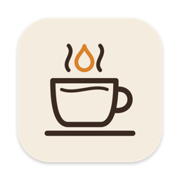
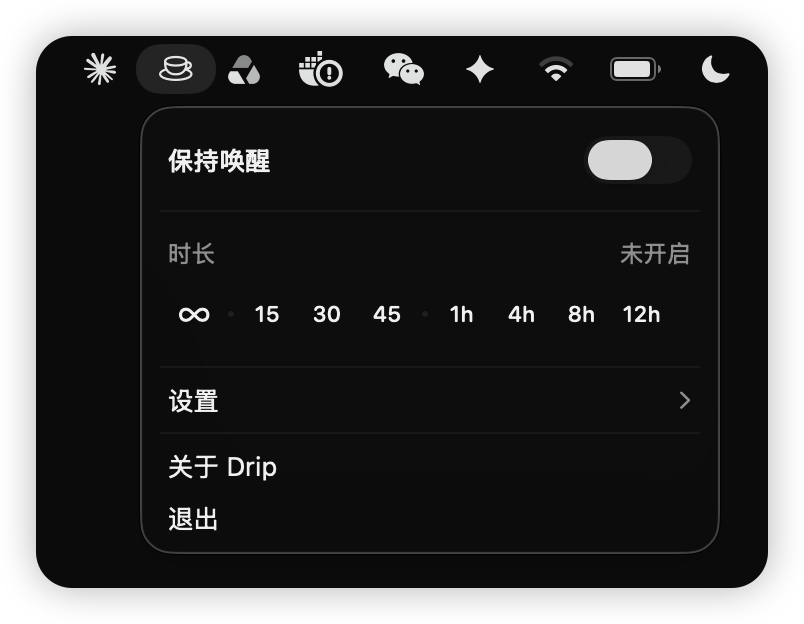
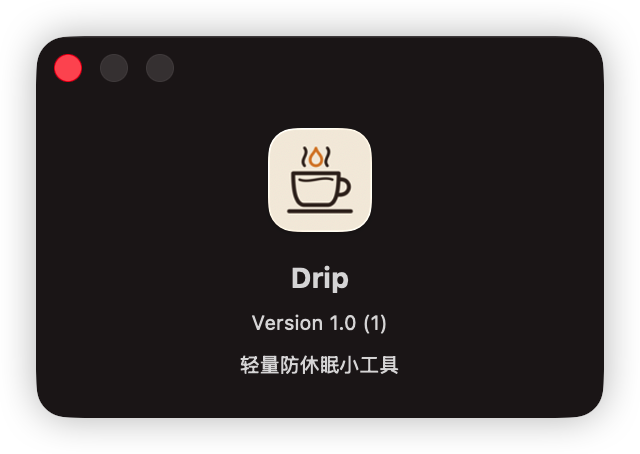

<div align="center">



# Drip

**A tiny, native menu bar app that keeps your Mac awake.**

One click. No Dock icon. Zero CPU when idle.

[](https://github.com/imelonkid/drip/releases/latest)
[](#requirements)
[](https://swift.org)
[](https://developer.apple.com/xcode/swiftui/)
[](LICENSE)

English · [简体中文](README.zh-CN.md)

</div>

---

<p align="center">
  
  &nbsp;
  
</p>

## Why Drip?

Running a long build, a download, a presentation, or a remote session, and you don't want your Mac to doze off? Drip sits in your menu bar as a little coffee cup. Turn it on and your Mac stays awake, either indefinitely or for a set amount of time.

It's the `caffeinate` command with a friendly face, and it's built to stay out of your way.

## Features

- ☕ **One-click toggle.** The cup fills in when Drip is keeping your Mac awake.
- ⏱️ **Timed sessions.** ∞, 15 / 30 / 45 minutes, or 1 / 4 / 8 / 12 hours. Tap a duration and it starts right away.
- ⏳ **Live countdown** while the panel is open.
- 🖥️ **Display or system only.** Keep the screen on, or just stop the Mac from sleeping and let the display turn off.
- 🚀 **Launch at login**, and optionally turn on automatically at launch.
- 🔔 **Update notice.** When a new version is out, Drip tells you once and links to the download. You can skip a version.
- 🪶 **Featherweight.** About a 380 KB app, no dependencies. The only background work is a tiny update check every 6 hours.

## How it works

Drip holds a single [IOKit power assertion](https://developer.apple.com/documentation/iokit/1557092-iopmassertioncreatewithname), the same mechanism `caffeinate` and video players use:

| Setting | Assertion |
| --- | --- |
| Keep display on (default) | `PreventUserIdleDisplaySleep` |
| Display may sleep | `PreventUserIdleSystemSleep` |

Timed sessions use one one-shot timer that releases the assertion when it fires. Nothing ticks in the background, and the countdown only re-renders while the panel is visible. You can check it at any time:

```bash
pmset -g assertions | grep Drip
```

## Installation

### Download

1. Grab the `.dmg` from the [latest release](https://github.com/imelonkid/drip/releases/latest).
2. Open it and drag **Drip** onto **Applications**.

Drip is signed with a Developer ID and notarized by Apple, so it opens normally.

### Build from source

You only need the Xcode **Command Line Tools**, not the full Xcode:

```bash
git clone https://github.com/imelonkid/drip.git
cd drip
./build.sh install
```

This builds a release binary, wraps it into `Drip.app`, ad-hoc signs it, copies it to `/Applications`, and launches it.

> [!NOTE]
> To only build without installing, run `./build.sh`. The app ends up in `build/Drip.app`.

## Requirements

- macOS 13 Ventura or later
- Apple Silicon (arm64)
- To build from source: Xcode Command Line Tools (`xcode-select --install`)

## Project structure

```
drip/
├── Sources/Drip/
│   ├── DripApp.swift         # MenuBarExtra entry point
│   ├── CaffeineModel.swift   # power assertion, timer, settings
│   ├── PanelView.swift       # the menu bar panel UI
│   ├── UpdateChecker.swift   # reads latest.json, offers new versions
│   └── SemVer.swift          # version comparison (unit-tested on Linux)
├── Resources/
│   ├── Info.plist            # LSUIElement (no Dock icon); version injected at build
│   ├── AppIcon.icns
│   └── make_icon.swift       # draws the app icon in code
├── Tests/SemVer/             # SemVer unit tests
├── scripts/
│   ├── package-desktop.sh    # build and bundle Drip.app (shared by build.sh and CI)
│   ├── release-desktop.sh    # DMG, latest.json, upload (run by CI)
│   └── ci-test.sh            # PR checks
├── .github/workflows/        # PR checks, release pipeline
├── build.sh                  # local build and install
└── Package.swift
```

## FAQ

<details>
<summary><b>Does it keep my Mac awake with the lid closed?</b></summary>

No. macOS always sleeps on lid close unless you're in clamshell mode, with external display and power connected. Drip prevents *idle* sleep.
</details>

<details>
<summary><b>macOS says the app can't be opened.</b></summary>

Releases from v1.1.0 on are notarized and open normally. Older downloads (v1.0.x) were not: delete them and install the latest release.
</details>

<details>
<summary><b>"Launch at login" doesn't stick.</b></summary>

Make sure the app is in `/Applications`. `./build.sh install` puts it there.
</details>

## Contributing

Issues and pull requests are welcome. Drip is intentionally small, so features that keep it simple and lightweight have the best chance of landing.

## License

[MIT](LICENSE) © melonkid

